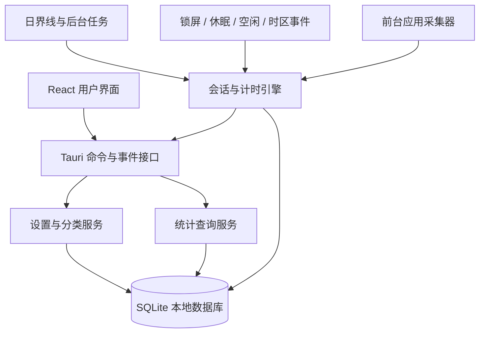

# 软件使用时长统计软件：顶层规划

> 文档版本：V1.0  
> 目标平台：Windows 10/11、macOS 13+  
> 产品形态：常驻后台的跨平台桌面应用  
> 核心原则：本地优先、低资源占用、隐私透明、统计可信

## 1. 产品概述

本软件用于自动记录用户在电脑上使用各个前台应用的时长，并允许将应用归入“学习”“游戏”“工作”“娱乐”等分类。首页以类似苹果“屏幕使用时间”小组件的信息层级，展示今日总使用时长、各分类总时长、应用排行和时间分布。

应用应常驻系统托盘或菜单栏，在不影响日常使用的前提下持续统计。每天 0 点首页自动进入新一天，今日数据从 0 开始计算；历史记录继续保留，可按日、周、月查看。

## 2. 产品目标

### 2.1 核心目标

1. 准确统计 Windows 和 macOS 上前台应用的有效使用时长。
2. 支持应用分类，并汇总每个分类的使用时长。
3. 用简洁、易扫读的首页展示当天使用情况。
4. 正确处理空闲、锁屏、休眠、跨零点等边界场景。
5. 默认仅在本机保存数据，不上传用户行为记录。
6. 保持较低的 CPU、内存和电量占用。

### 2.2 非目标（首个版本不做）

- 不记录键盘输入内容、网页正文、聊天内容或屏幕画面。
- 不提供家长控制、强制锁定应用或远程监控。
- 不在首版实现跨设备云同步、团队管理或移动端。
- 不以窗口标题作为核心统计对象，避免采集敏感信息。

## 3. 目标用户与使用场景

### 3.1 目标用户

- 希望了解学习、工作和娱乐时间分配的个人用户。
- 需要复盘软件使用情况的学生、开发者和自由职业者。
- 关注数字健康，但不希望行为数据上传云端的用户。

### 3.2 典型场景

- 用户打开电脑后，软件自动在后台运行并开始统计。
- 用户在浏览器、IDE、文档软件之间切换，系统自动累计各应用时长。
- 用户将 VS Code、Word 归为“学习”，将 Steam 游戏归为“游戏”。
- 用户在首页查看今天各分类占比和使用最多的应用。
- 用户离开电脑超过设定时间，离开期间不计入使用时长。
- 零点到达时，新一天从 0 开始，前一天数据可在历史页面查看。

## 4. 功能范围

### 4.1 首页仪表盘

首页采用紧凑的小组件式布局，但不直接复制苹果的视觉资产。

主要内容：

- 今日总使用时长。
- 与昨日或近 7 日均值的对比。
- 24 小时使用柱状图，按分类堆叠显示。
- 分类列表：分类名称、颜色、时长和占比。
- 应用排行：图标、名称、所属分类、今日时长。
- 当前正在使用的应用及本次连续使用时长。
- 日期切换入口，用于查看历史日期。

建议桌面布局：

```text
┌──────────────────────────────────────────────────────────┐
│ 今天                         2026/07/23        设置       │
├──────────────────────────────┬───────────────────────────┤
│ 今日总时长                   │ 分类                       │
│ 4 小时 26 分钟               │ 学习  2h 10m   49%        │
│ 较昨日 -18%                  │ 工作  1h 25m   32%        │
│                              │ 游戏     51m   19%        │
├──────────────────────────────┴───────────────────────────┤
│ 00  03  06  09  12  15  18  21             时间分布     │
├──────────────────────────────────────────────────────────┤
│ 使用最多的应用                                             │
│ VS Code    1h 32m   学习    Chrome  58m   工作           │
└──────────────────────────────────────────────────────────┘
```

### 4.2 前台应用时长统计

- 监听当前前台应用的切换事件。
- 用稳定的应用标识累计时长，而不是仅依赖可变的显示名称。
- 应用切换、锁屏、休眠、退出和日期跨越时及时结算当前会话。
- 设置低频心跳进行纠错，防止系统事件丢失。
- 默认只统计有效使用时间，空闲时间不计入应用时长。
- 用户可选择是否将短暂切换合并，建议默认不合并，保证规则直观。

### 4.3 分类管理

内置默认分类：

- 学习
- 工作
- 游戏
- 娱乐
- 社交
- 工具
- 未分类

分类能力：

- 新增、重命名、排序、修改颜色和删除自定义分类。
- 将一个或多个应用批量移动到某个分类。
- 新发现的应用默认进入“未分类”。
- 删除分类时，原有应用自动转入“未分类”，历史统计不丢失。
- 分类规则对历史记录的影响需明确：首版建议历史按“当前分类”动态汇总，交互简单；后续可增加“保留当时分类”的高级模式。

### 4.4 历史与趋势

- 按日查看总时长、分类时长和应用明细。
- 周视图和月视图展示趋势、日均时长及分类占比。
- 支持导出 CSV，便于用户自行分析和备份。
- 支持清除指定日期或全部统计数据，并进行二次确认。

### 4.5 设置

- 开机自动启动。
- 空闲判定阈值，默认 5 分钟，可选 1、3、5、10、15 分钟。
- 是否在锁屏、休眠时停止计时，默认开启且不可造成重复计时。
- 是否显示菜单栏或托盘图标。
- 是否显示通知，例如每日总结。
- 一周起始日、时间格式和主题模式。
- 数据导入、导出、备份与彻底删除。
- 权限状态和采集说明。

### 4.6 托盘与菜单栏

- 展示今日总时长和当前应用。
- 快速打开首页。
- 暂停或恢复统计。
- 退出应用。
- 暂停期间在首页明确标记，避免用户误以为正在记录。

## 5. 统计规则

统计可信度是本产品的核心。所有平台应遵循同一套业务规则。

### 5.1 会话定义

一次应用使用会话包含：

- 应用唯一标识。
- 开始时间与结束时间。
- 有效时长。
- 所属自然日。
- 会话结束原因，例如应用切换、空闲、锁屏、休眠、暂停、退出、跨零点。

### 5.2 推荐计时策略

1. 检测到前台应用切换时，结算上一个会话并开始新会话。
2. 每 10 秒执行一次轻量心跳，确认前台应用和系统状态。
3. 检测到用户空闲达到阈值时，将有效计时截止到最后一次输入时间。
4. 用户恢复操作时，从恢复时刻开始新会话，不补记空闲时间。
5. 锁屏、休眠、关机或应用退出时立即结算。
6. 发生系统时间手动调整时，以单调时钟计算本段耗时，以本地墙上时间决定归属日期。

### 5.3 每日 0 点重置

“重置”仅表示首页进入新的自然日，不删除前一天记录：

- 在用户当前系统时区的 0 点切分正在进行的会话。
- 0 点前的部分计入前一天，0 点后的部分计入新一天。
- 应用未运行时无需执行定时任务；下次启动时根据时间边界自然显示当天数据。
- 用户修改时区后，从修改时刻起采用新时区，不反复改写已完成会话。

### 5.4 异常数据防护

- 单次心跳间隔异常过长时，不直接把全部间隔计入使用时长。
- 进程崩溃后，下次启动根据最后心跳和合理上限修复未关闭会话。
- 多开应用只允许一个采集进程写入数据库。
- 数据库写入使用事务，避免部分记录损坏。

## 6. 技术架构

### 6.1 推荐技术选型

| 层级 | 推荐方案 | 选择原因 |
|---|---|---|
| 桌面框架 | Tauri 2 | 安装包和资源占用较小，适合常驻后台应用 |
| 核心服务 | Rust | 跨平台、性能稳定，便于调用 Win32 与 macOS 系统 API |
| 前端 | React + TypeScript | 组件生态成熟，适合仪表盘和数据可视化 |
| 样式 | CSS 变量 + 自建轻量组件 | 保持视觉统一，避免引入过重 UI 框架 |
| 图表 | ECharts 或 uPlot | 支持时间分布、堆叠图和交互提示 |
| 本地存储 | SQLite | 单机统计查询可靠，备份和迁移方便 |
| 数据访问 | SQLx 或 rusqlite | 类型清晰，支持事务与数据库迁移 |
| 日志 | tracing | 便于定位采集异常，生产环境可控制日志级别 |
| 自动更新 | Tauri Updater | 统一 Windows 与 macOS 更新流程 |

不建议使用纯 Electron 作为首选，因为本产品需要全天常驻，内存与电量占用会直接影响体验。如果团队更熟悉 Electron，也可以先快速验证产品，但应提前制定后台资源预算。

### 6.2 系统分层



### 6.3 模块划分

```text
src-tauri/
  platform/
    windows/        Windows 前台应用、空闲和电源事件
    macos/          macOS 前台应用、空闲和电源事件
  collector/        跨平台采集接口与事件标准化
  tracker/          会话状态机、空闲处理、跨零点切分
  storage/          SQLite、迁移、仓储与事务
  analytics/        日/周/月聚合与对比计算
  commands/         提供给前端的 Tauri 命令
  tray/             托盘、菜单栏与快捷操作
  settings/         配置、权限与数据管理

src/
  pages/            首页、历史、分类、设置
  components/       图表、分类列表、应用排行等
  stores/           前端状态与缓存
  services/         Tauri 调用封装
  theme/            颜色、间距、字体与深浅主题
```

## 7. 平台采集方案

### 7.1 Windows

建议使用的系统能力：

- `SetWinEventHook(EVENT_SYSTEM_FOREGROUND)` 监听前台窗口变化。
- `GetForegroundWindow` 作为启动检测和心跳纠错。
- `GetWindowThreadProcessId` 获取进程 ID。
- `OpenProcess` 与 `QueryFullProcessImageName` 获取可执行文件路径。
- Windows 应用模型 API 补充 UWP / 打包应用的显示名称与图标。
- `GetLastInputInfo` 判断键盘鼠标空闲时间。
- `WTSRegisterSessionNotification` 监听锁屏和解锁。
- `RegisterPowerSettingNotification` 或系统电源事件监听休眠与恢复。

应用稳定标识优先使用规范化后的可执行文件路径，并保留发布者或包标识作为补充。需要处理权限级别不同导致的进程信息读取失败，此时退化到可执行文件名和进程 ID 的短期映射。

### 7.2 macOS

建议使用的系统能力：

- `NSWorkspace.didActivateApplicationNotification` 监听前台应用切换。
- `NSWorkspace.shared.frontmostApplication` 用于启动检测和心跳纠错。
- 使用 `bundleIdentifier` 作为应用稳定标识。
- 使用 `localizedName` 和应用 Bundle 获取图标。
- 使用 Quartz 的系统空闲时间能力判断用户空闲。
- 使用 `NSWorkspace` 的休眠、唤醒与会话通知处理系统状态。
- 使用 `SMAppService` 管理登录时启动。

仅统计前台应用本身通常不需要屏幕录制权限。首版不要读取窗口标题或屏幕内容，以减少权限申请和隐私风险。发布前需根据最终 API 做真机权限验证。

### 7.3 统一平台接口

平台层向上只输出标准事件：

```text
ForegroundChanged(app)
UserBecameIdle(last_input_at)
UserBecameActive(at)
SessionLocked(at)
SessionUnlocked(at)
SystemSleeping(at)
SystemWoke(at)
TimezoneChanged(timezone)
ShutdownRequested(at)
```

计时和分类逻辑不得散落在平台代码中，以便两个平台共享同一套统计规则和测试用例。

## 8. 数据设计

### 8.1 核心实体

| 实体 | 关键字段 | 说明 |
|---|---|---|
| `apps` | `id`, `platform`, `stable_key`, `name`, `icon_key`, `category_id` | 已发现的应用 |
| `categories` | `id`, `name`, `color`, `sort_order`, `is_system` | 分类定义 |
| `sessions` | `id`, `app_id`, `started_at`, `ended_at`, `duration_seconds`, `local_date`, `end_reason` | 原始有效会话 |
| `daily_app_stats` | `local_date`, `app_id`, `duration_seconds` | 可选的日聚合缓存 |
| `settings` | `key`, `value` | 用户设置 |
| `schema_migrations` | `version`, `applied_at` | 数据库版本迁移 |

### 8.2 数据约束

- `apps(platform, stable_key)` 唯一。
- 所有持久化时间点使用 UTC 时间戳，同时保存统计所需的本地日期和时区信息。
- `duration_seconds` 不允许为负数。
- 原始会话作为事实数据，聚合表可随时重建。
- 数据库默认存放在各平台标准应用数据目录，不放在安装目录。

### 8.3 数据保留

- 默认永久保留，用户可主动清除。
- 提供数据库备份和 CSV 导出。
- 图标单独缓存并设置大小上限。
- 日志默认不包含窗口标题、文件名或用户输入内容。

## 9. 交互与视觉方向

### 9.1 视觉原则

- 信息密度适中，突出“今天用了多久”和“时间花在哪里”。
- 使用中性色背景和清晰的分类色，不让单一品牌色占据整个界面。
- 卡片圆角控制在 8px 内，阴影轻微或不用阴影。
- 图表颜色与分类颜色保持一致，同时提供图例和文字，避免只靠颜色区分。
- 支持浅色、深色和跟随系统。
- Windows 与 macOS 保持同一信息架构，但窗口、菜单栏和托盘交互遵循各自平台习惯。

### 9.2 无障碍与适配

- 关键文字和图表满足基本对比度要求。
- 支持键盘导航和清晰的焦点状态。
- 图表提供文字摘要或列表视图。
- 最小窗口建议为 900 × 600，首页支持较小窗口下的单列布局。
- 时长显示统一，例如“小于 1 分钟”“1 小时 08 分钟”，避免同页格式混乱。

## 10. 隐私与安全

- 首次启动明确说明采集范围、存储位置和暂停方式。
- 所有使用记录默认只保存在本机。
- 不采集键盘内容、截图、文件内容和网页正文。
- 若未来增加云同步，必须单独征得同意并提供端到端加密方案。
- 数据导出和删除操作由用户主动触发。
- 更新包必须签名并校验来源。
- Windows 发布使用代码签名证书；macOS 使用 Developer ID 签名并完成公证。
- 调试日志中的路径、账户名等信息需脱敏。

## 11. 性能目标

首版建议设定以下验收预算，并在真机上持续测量：

- 后台稳定状态平均 CPU 占用低于 0.5%。
- 后台内存占用目标低于 100 MB。
- 每日数据库增长通常低于 1 MB。
- 前台应用切换后 1 秒内反映到当前状态。
- 首页常规查询和渲染在 300 ms 内完成。
- 不使用高频轮询；事件驱动为主，10 秒心跳仅用于纠错。

## 12. MVP 与版本路线

### 12.1 MVP（V0.1）

- Windows 和 macOS 前台应用识别。
- 应用切换、空闲、锁屏、休眠和跨零点计时。
- SQLite 本地存储。
- 今日总时长、分类汇总、应用排行和 24 小时分布。
- 默认分类与应用分类管理。
- 托盘或菜单栏常驻、暂停统计、开机启动。
- 基本数据导出和清除。
- 浅色、深色主题。

### 12.2 V1.0

- 日、周、月历史趋势。
- 昨日和近 7 日均值对比。
- 每日总结通知。
- 完整安装包、签名、公证和自动更新。
- 崩溃恢复、数据库迁移与备份恢复。
- 完整无障碍和多语言基础设施。

### 12.3 后续候选

- 网站级别统计，但必须单独设计浏览器扩展和隐私授权。
- 专注目标、分类限额和提醒。
- 加密的跨设备同步。
- 规则化自动分类，例如按发布者或安装来源分类。
- 菜单栏或任务栏迷你统计视图。

## 13. 项目里程碑

以 2 至 3 人小团队为参考，MVP 预计 10 至 14 周：

| 阶段 | 建议周期 | 主要交付物 |
|---|---:|---|
| 需求与原型 | 1 周 | 规则确认、页面线框、验收标准 |
| 技术验证 | 1 至 2 周 | 两个平台的前台应用、空闲、锁屏与休眠 PoC |
| 核心引擎 | 2 周 | 会话状态机、跨零点、SQLite、崩溃恢复 |
| 产品功能 | 2 至 3 周 | 首页、分类、历史基础、设置、托盘 |
| 平台完善 | 2 周 | 开机启动、权限、图标、安装和更新 |
| 测试与优化 | 2 周 | 边界测试、资源优化、真机兼容性测试 |
| 发布准备 | 1 至 2 周 | 签名、公证、隐私说明、发布包 |

第一阶段必须先完成平台技术验证。前台应用识别和系统状态监听是项目最大的不确定性，不应在 UI 完成后才验证。

## 14. 测试策略

### 14.1 核心单元测试

- 普通应用切换的时长结算。
- 空闲阈值前后计时。
- 锁屏、解锁、休眠和恢复。
- 23:59:50 到 00:00:10 的跨日切分。
- 夏令时、时区切换和系统时间回拨。
- 心跳丢失、进程崩溃和异常退出恢复。
- 分类新增、删除和历史汇总。

### 14.2 平台集成测试

- Windows 10、Windows 11，普通桌面应用、UWP 和管理员权限应用。
- macOS Intel 与 Apple Silicon，多个系统版本。
- 多显示器、全屏应用、快速用户切换和远程桌面场景。
- 电脑连续运行 24 小时、睡眠过夜和跨零点不关机。
- 开机启动、升级安装、数据库迁移和卸载后数据策略。

### 14.3 验收标准

- 连续 8 小时真实使用中，统计误差不超过 2%，且不存在明显重复计时。
- 锁屏和休眠时间不计入有效使用时长。
- 跨零点会话准确分配到两天。
- 未授权或暂时无法读取应用详情时，采集服务不崩溃。
- 重启应用或系统后，历史数据完整且当前统计能自动恢复。
- 首页分类总和与应用总和、今日总时长一致。

## 15. 主要风险与应对

| 风险 | 影响 | 应对措施 |
|---|---|---|
| 平台 API 行为差异 | 两端统计结果不一致 | 统一事件模型和状态机，平台层只负责采集 |
| 权限不足无法识别部分应用 | 应用名称或图标缺失 | 分级退化、权限说明和稳定的未知应用处理 |
| 休眠或崩溃造成超长会话 | 使用时长虚高 | 单调时钟、心跳上限、系统事件和恢复修正 |
| macOS 发布限制 | 无法顺利安装或更新 | 尽早完成签名、公证和权限真机验证 |
| 常驻应用资源过高 | 用户卸载或禁用自启 | 事件驱动采集、性能预算和长时间压力测试 |
| 分类口径变化引起历史差异 | 用户理解混乱 | 首版明确采用当前分类动态汇总，并在 UI 说明 |
| 隐私疑虑 | 用户不信任产品 | 本地存储、最小采集、透明权限和一键删除 |

## 16. 关键决策

进入详细设计前需要产品负责人最终确认以下决策：

1. 空闲时间是否完全排除，默认阈值是否为 5 分钟。
2. 历史统计是否跟随应用当前分类重新计算。
3. 首版是否必须同时发布 Windows 和 macOS，还是 Windows 先行验证后再发布 macOS。
4. 是否保留原始会话明细，建议保留以支持修复和重新聚合。
5. 是否需要周/月历史视图进入 MVP。
6. 是否需要上架 Microsoft Store 或 Mac App Store；不同渠道会影响权限、签名和更新方案。

## 17. 推荐的下一步

1. 用低保真原型确认首页、分类页、历史页和设置页的信息架构。
2. 分别在 Windows 和 macOS 制作 3 至 5 天的采集 PoC，验证前台应用、空闲、锁屏、休眠和跨零点。
3. 用真实使用日志评估准确率和资源占用，再冻结统计规则。
4. 确认发行渠道、签名预算和最低系统版本。
5. 在技术验证通过后进入数据库、状态机和正式 UI 开发。
